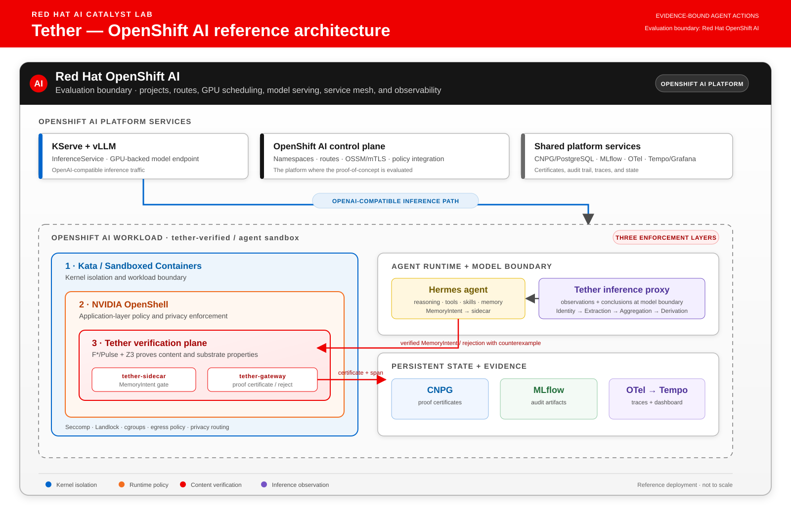

# Project Tether

**Formally verified AI agent runtime evaluated on Red Hat OpenShift AI — proving correctness of LLM reasoning, agent decisions, tool use, and persistent memory.**

Tether bridges formal proof logic (F\*/Pulse separation logic, Z3 SMT solver) with AI agent runtimes (Hermes, OpenClaw) and sandboxed execution (NVIDIA OpenShell) to provide machine-checked guarantees across the full agent action chain: from LLM inference through tool execution to persistent state.

*Tether — evidence-bound action.*

**Namespace:** `tether-verified` (verification gateway sidecar to agent pods)

## Overview

### The Problem

Autonomous AI agents act across four surfaces — each unverified today:

1. **LLM reasoning** — the model's inference chain may be unsound, hallucinated, or manipulated
2. **Agent decisions** — the agent's choice of what to do next may violate safety constraints or policy
3. **Tool use** — tool calls may produce side effects beyond their stated scope
4. **Persistent memory** — stored facts may be poisoned (OWASP ASI06), contradictory, or logically unsound, compounding errors across sessions

No current framework provides formal guarantees across this chain.

### The Solution

Tether interposes a verification gateway in the agent runtime. Every action passes through two verification layers:

- **Content verification** (F\* refinement types + Z3) — proves reasoning is logically sound, consistent, and not poisoned
- **Substrate verification** (Pulse separation logic + Z3) — proves operations preserve ownership, frame isolation, bounds, and concurrency safety

Both layers generate verification conditions that Z3 discharges. Actions proceed only on proof; rejections include counterexamples for agent retry.

### Architecture



The reference architecture treats **Red Hat OpenShift AI as the evaluation
boundary**, not merely as a generic Kubernetes cluster. KServe/vLLM model
serving, OpenShift platform services, the three enforcement layers, shared
state, and observability are shown together in the rendering above. An
[interactive version](tether-architecture.html) is also available for
presentation and PDF export.

## Prerequisites

| Dependency | Version | Purpose |
|------------|---------|---------|
| F\* + Pulse | v2026.05.17+ | Proof-oriented programming, separation logic |
| Z3 | 4.13+ | SMT solver (installed with F\*) |
| Claude Code | Current | Agent for proof generation via proof-copilot |
| proof-copilot plugin | Latest | F\*/Pulse skills for Claude Code |
| NVIDIA OpenShell | Alpha | Agent sandbox with policy enforcement |
| Python | 3.11+ | Verification gateway service |

### Install F\* and Pulse

```bash
curl -fsSL https://aka.ms/install-fstar | bash -s -- --release
```

Installs `fstar.exe` and Z3 to `~/.local/bin/`.

### Install proof-copilot Plugin (Claude Code)

```text
/plugin marketplace add FStarLang/proof-copilot
/plugin install proof-copilot@proof-copilot
```

Provides the `fstar-coder` agent and 8 skills: `fstarverifier`, `fstarmcp`, `smtprofiling`, `proofdebugging`, `specreview`, `krmlextraction`, `projectsetup`, `sourcebuild`.

### Install OpenShell

```bash
pip install openshell
```

## Project Structure

```text
project-tether/
├── README.md                      # This file
├── ARCHITECTURE.md                # Detailed design, verification properties, PoC phases
├── PAPER.md                       # Full paper in Markdown
├── .gitignore                     # F* build artifacts, configs with secrets
├── specs/
│   ├── VerifiedWrite.fst          # Composed: P1-P4 + P5+P7 with separation logic
│   ├── VerifiedSkillWrite.fst     # Composed: skill verify + bounded persist
│   ├── content/                   # Content verification (P1-P4)
│   │   ├── TetherTypes.fst        # Core algebraic types, trust levels, evidence
│   │   ├── TetherPredicates.fst   # Rule validators, chain_well_formed, no_contradiction
│   │   ├── AgentReasoning.fst     # P1-P4 composition: inference, consistency, poison, completeness
│   │   ├── AgentReasoning.fsti    # Interface: content verification predicates
│   │   ├── PoisonDetection.fst    # P3: OWASP ASI06 pattern matching
│   │   ├── PoisonDetection.fsti   # Interface: poison detection predicates
│   │   ├── CompletenessCheck.fst  # P4: domain-spec completeness
│   │   ├── CompletenessCheck.fsti # Interface: completeness predicates
│   │   ├── SkillVerification.fst  # Surface 2: generated skill verification
│   │   ├── SkillVerification.fsti # Interface: skill safety predicates
│   │   ├── TemporalValidity.fst   # Surface 4: proof certificate expiry
│   │   ├── TemporalValidity.fsti  # Interface: temporal validity predicates
│   │   ├── TetherNormTests.fst    # 20 assert_norm tests on concrete inputs
│   │   └── TetherLemmas.fst       # 10 incorrectness lemmas (L1-L10)
│   └── substrate/                 # Substrate verification (P5-P10)
│       ├── AgentState.fst         # P5 ownership, P7 bounds (Pulse separation logic)
│       ├── AgentState.fsti        # Interface: substrate verification predicates
│       ├── ToolScope.fst          # P9 tool scope, P10 side-effect containment
│       ├── ToolScope.fsti         # Interface: tool verification predicates
│       ├── ProofTransport.fst     # Surface 5: multi-agent proof witness transport
│       └── ProofTransport.fsti    # Interface: cross-agent verification predicates
├── paper/
│   ├── main.tex                   # ACM acmart (sigplan) LaTeX paper
│   ├── references.bib             # 16 BibTeX entries
│   └── Makefile                   # Build PDF with tectonic
├── src/tether/
│   └── server.py                  # gRPC verification gateway server
├── tests/tether/
│   ├── gateway_client.py          # Python mirror of F* specs (runtime engine)
│   ├── owasp_asi06_vectors.py     # 31 OWASP ASI06 attack vectors
│   └── test_*.py                  # 175 tests across 6 test files
├── proto/
│   └── tether.proto               # gRPC service definition (7 RPCs, 30+ messages)
├── config/
│   ├── tether-config.example.yaml # Verification gateway configuration
│   └── openshell-policy.yaml      # OpenShell sandbox policy for Tether agents
├── deployment.yaml                # Verification gateway deployment
├── service.yaml                   # Verification gateway service
├── sidecar-patch.yaml             # Inject Tether as sidecar to kagent agent pods
├── hermes-sidecar-patch.yaml      # Hermes-specific sidecar with OpenShell init
└── scripts/
    ├── run-demo.sh                # Full demo runner (F* verify + MCP + pytest + demo)
    ├── demo.py                    # Interactive 5-surface demo (7 scenarios)
    ├── verify-specs.sh            # Run F* verification on all 22 specs
    ├── install-fstar.sh           # F*/Pulse/Z3 toolchain setup
    └── build-gateway.sh           # Container image build (Podman)
```

## Verification Properties

### Content (F\* refinement types → Z3)

| ID | Property | Verification Target | What It Catches |
|----|----------|-------------------|----------------|
| P1 | Inference soundness | LLM reasoning chain | Model hallucinates a "fact" not grounded in observations |
| P2 | Consistency | Agent knowledge base | New fact contradicts existing state |
| P3 | Poisoning resistance | All persisted content | Prompt injection stored as trusted memory (OWASP ASI06) |
| P4 | Completeness | Agent decision coverage | Critical observation or action not captured |

### Substrate (Pulse separation logic → Z3)

| ID | Property | Verification Target | What It Catches |
|----|----------|-------------------|----------------|
| P5 | Ownership | Memory regions | Agent writes to another agent's state |
| P6 | Frame rule | All agent state | Write to one region corrupts another |
| P7 | Bounds | Tier constraints | Write exceeds tier limits (Hermes: 2200 chars) |
| P8 | Concurrency | Shared state | Concurrent sessions corrupt shared tiers |

### Tool Use (F\* + Pulse → Z3)

| ID | Property | Verification Target | What It Catches |
|----|----------|-------------------|----------------|
| P9 | Tool scope | Tool call arguments | Tool called with arguments outside its declared API surface |
| P10 | Side-effect containment | Tool execution state | Tool produces side effects beyond its specified output |

## Integration with Catalyst Lab

| Component | Integration Point |
|-----------|------------------|
| **Kagent** (11 agents) | Tether runs as sidecar to agent pods; verifies all agent actions |
| **OTel Collector** | Proof certificates emitted as OTel spans (`tether.proof.*` attributes) |
| **MLflow** | Proof certificates logged as experiment metadata for audit |
| **Tempo + Grafana** | Verification latency dashboard, rejection rate monitoring |
| **PostgreSQL (CNPG)** | Proof certificate storage |
| **LLaMA Stack** | Agent inference and tool calls pass through verification gateway |
| **Istio** | mTLS between agent and verification gateway |
| **OpenShell** | Sandbox isolation; Policy Engine enforces runtime constraints |

## Usage

### Verify Specs Locally

```bash
# Verify all F*/Pulse specs
./scripts/verify-specs.sh

# Verify a single spec
fstar.exe --include specs/ specs/content/AgentReasoning.fst
```

### Generate Proofs with Claude Code

Use the proof-copilot plugin to generate and verify Pulse proofs:

```text
"Use the fstar-coder agent to write a Pulse function that verifies
 agent memory ownership with the frame rule for a Hermes-style
 MEMORY.md bounded to 2200 characters"
```

```text
"Use the fstar-coder agent to write an F* spec that verifies
 a tool call's arguments are within the declared API surface
 and its return value matches the expected output type"
```

Use `smtprofiling` if Z3 discharge is slow:

```text
"Use the smtprofiling skill to diagnose why P8 concurrency proof
 is timing out"
```

### Deploy to Cluster

```bash
# Create verification gateway
kubectl apply -f project-tether/deployment.yaml

# Patch kagent agent pods with Tether sidecar
kubectl -n kagent patch deployment kagent-controller \
  --patch-file project-tether/sidecar-patch.yaml
```

## Technology Stack

| Component | Technology | License |
|-----------|-----------|---------|
| Proof language | F\* + Pulse (separation logic DSL) | Apache 2.0 |
| SMT solver | Z3 | MIT |
| Agent tooling | Claude Code + proof-copilot plugin | Apache 2.0 |
| Incremental checking | F\* MCP Server (Rust) | Apache 2.0 |
| Compiled proofs | KaRaMeL (F\* → C extraction) | Apache 2.0 |
| Agent sandbox | NVIDIA OpenShell | Apache 2.0 |
| Memory patterns | Hermes Agent / OpenClaw | MIT |
| Observability | OpenTelemetry | Apache 2.0 |

## Status

| Phase | Description | Status |
|-------|-------------|--------|
| 0 | Single verified action (P1, P2, P5, P7) | **Complete** |
| 1 | Content + tool use verification with OWASP test vectors | **Complete** |
| 2 | Full Pulse substrate model (Hermes + OpenClaw + tool scope) | **Complete** |
| 3 | OpenShift AI integration (sidecar, OTel, Grafana dashboard) | Partial (manifests ready) |
| 4 | Multi-agent fleet + EU AI Act compliance trail | Not started |

## References

- [Agentic Proof-Oriented Programming in F\*](https://fstar-lang.org/tutorial/book/agentic/agentic_getting_started.html)
- [FStarLang/proof-copilot](https://github.com/FStarLang/proof-copilot)
- [Pulse DSL for F\*](https://github.com/FStarLang/pulse)
- [PulseCore (PLDI 2025)](https://fstar-lang.org/papers/pulsecore.pdf)
- [NVIDIA OpenShell](https://github.com/NVIDIA/OpenShell)
- [Hermes Agent Memory System](https://hermes-agent.org/)
- [OpenClaw Memory Architecture](https://docs.openclaw.ai/concepts/memory)
- [AxDafny: Verified Code Generation](https://axiomatic-ai.com/blog/axdafny/)
- [RAND: Verified ML Infrastructure (2026)](https://www.rand.org/pubs/research_reports/RRA4881-1.html)
